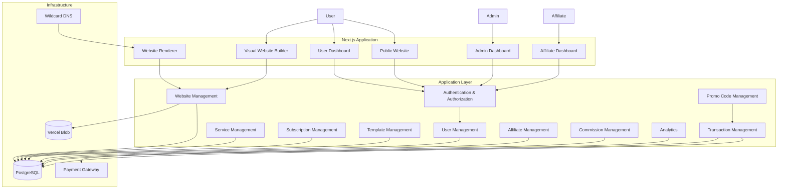
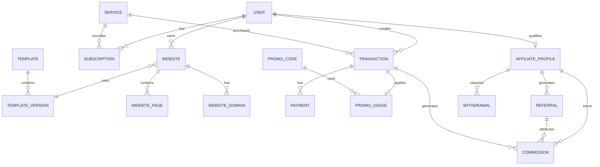
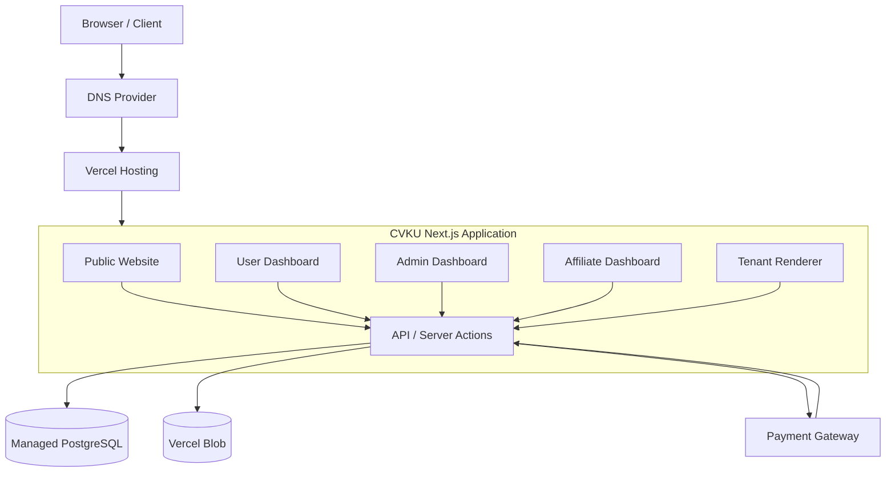

# Arsitektur Sistem CVKU

**Platform:** CVKU — Multi-Tenant Website Builder SaaS  
**Domain utama:** `cvku.giize.com`  
**Wildcard domain:** `*.cvku.giize.com`  
**Arsitektur:** Modular Monolith, Multi-Tenant SaaS  
**Frontend dan Backend:** Next.js  
**Database:** PostgreSQL  
**ORM:** Prisma  

---

# 1. Gambaran Umum Sistem

CVKU merupakan platform SaaS berbasis multi-tenant yang memungkinkan pengguna membuat, mengelola, dan mempublikasikan website menggunakan template yang telah disediakan oleh platform.

Pengguna tidak perlu memiliki kemampuan pemrograman untuk membuat website. Mereka cukup memilih template, mengisi konten, mengatur tampilan melalui editor visual, kemudian mempublikasikan website menggunakan subdomain CVKU.

Platform memiliki tiga aktor utama:

1. **User** — pengguna yang membeli layanan dan membuat website.
2. **Admin** — pengelola platform yang mengatur layanan, template, pengguna, transaksi, promo code, dan affiliate.
3. **Affiliate** — pengguna yang memenuhi persyaratan program affiliate dan memperoleh komisi dari transaksi pengguna yang berhasil direferensikan.

Affiliate bukan akun atau jenis role yang sepenuhnya terpisah. Affiliate merupakan kemampuan tambahan pada akun User yang memenuhi persyaratan program.

## 1.1 Tujuan Sistem

- Menyediakan layanan pembuatan website tanpa coding.
- Memungkinkan satu pengguna memiliki beberapa website.
- Menyediakan template website yang dapat dikelola melalui dashboard admin.
- Menyediakan sistem layanan, paket, harga, dan langganan yang dinamis.
- Menyediakan sistem referral affiliate dengan perhitungan komisi.
- Menyediakan sistem promo code yang dapat memberikan potongan harga sesuai konfigurasi admin.
- Menyediakan dashboard administrasi untuk memantau seluruh aktivitas platform.
- Memungkinkan penambahan fitur dan komponen website tanpa mengubah keseluruhan arsitektur.

## 1.2 Prinsip Arsitektur

CVKU menggunakan pendekatan **Modular Monolith**.

Artinya, aplikasi tetap dikembangkan dalam satu project utama, tetapi setiap domain bisnis memiliki modul, tanggung jawab, dan batasan yang jelas.

Pendekatan ini dipilih karena:

- Lebih sederhana untuk dikembangkan dan dipelihara dibandingkan microservices.
- Tidak memerlukan infrastruktur komunikasi antarlayanan yang kompleks.
- Memudahkan transaksi database yang melibatkan beberapa modul.
- Modul dapat dipisahkan menjadi layanan independen jika skala bisnis nantinya membutuhkan.

Arsitektur tidak perlu langsung menggunakan microservices. Pemisahan modul yang baik sudah cukup untuk mempersiapkan pengembangan jangka panjang.

---

# 2. Teknologi yang Digunakan

| Bagian | Teknologi | Tanggung Jawab |
|---|---|---|
| Framework | Next.js App Router | Routing, rendering, API, dan server-side logic |
| Bahasa | JavaScript | Pengembangan aplikasi |
| UI Library | React.js | Antarmuka pengguna |
| Styling | CSS / Tailwind CSS | Tampilan dan layout |
| Database | PostgreSQL | Penyimpanan data utama |
| ORM | Prisma | Pengelolaan database |
| Authentication | Auth.js atau solusi autentikasi yang dipilih | Login dan session |
| Validation | Zod | Validasi data |
| File Storage | Vercel Blob | Penyimpanan gambar dan file |
| Hosting | Vercel Pro | Deployment aplikasi |
| DNS | Dynu DNS | Pengelolaan domain dan wildcard DNS |
| Payment Gateway | Provider pembayaran yang diintegrasikan | Pembayaran transaksi |
| Analytics | Internal analytics | Statistik website dan aktivitas platform |

**Catatan:** Payment gateway belum dikunci pada satu provider. Integrasi sebaiknya dibuat melalui adapter agar provider dapat diganti tanpa mengubah logika utama transaksi.

---

# 3. Struktur Aktor dan Hak Akses

## 3.1 User

User merupakan pelanggan utama CVKU.

Hak akses:

- Membuat dan mengelola profil.
- Melihat layanan dan paket yang tersedia.
- Membeli layanan.
- Menggunakan promo code.
- Memilih template website.
- Membuat website berdasarkan template.
- Mengedit konten website.
- Mengelola beberapa website sesuai batas layanan.
- Mempublikasikan dan menonaktifkan website.
- Melihat statistik website.
- Melihat riwayat transaksi.
- Melihat status langganan.
- Mengakses program affiliate apabila memenuhi persyaratan.

## 3.2 Admin

Admin merupakan pengelola utama platform.

Hak akses:

- Melihat statistik keseluruhan platform.
- Mengelola pengguna.
- Mengelola layanan dan paket harga.
- Mengelola template website.
- Membuat dan mempublikasikan versi template.
- Mengelola langganan.
- Mengelola promo code.
- Mengatur persyaratan affiliate.
- Mengelola affiliate.
- Memantau referral dan komisi.
- Memproses permintaan penarikan komisi.
- Melihat transaksi.
- Mengelola konfigurasi platform.

Admin memiliki akses administratif, tetapi seluruh aktivitas sensitif tetap harus tercatat melalui audit log.

## 3.3 Affiliate

Affiliate merupakan User yang telah memenuhi persyaratan program affiliate.

Hak akses:

- Melihat kode referral pribadi.
- Membagikan tautan referral.
- Melihat jumlah pengguna yang berhasil direferensikan.
- Melihat status referral.
- Melihat transaksi yang memenuhi syarat komisi.
- Melihat total komisi.
- Melihat komisi yang masih menunggu persetujuan.
- Mengajukan penarikan komisi.
- Melihat riwayat penarikan.

Affiliate tidak memiliki akses ke pengelolaan layanan, template, pengguna lain, atau konfigurasi platform.

## 3.4 Model Role dan Permission

Gunakan role utama berikut:

```prisma
enum UserRole {
  USER
  ADMIN
}
```

Affiliate tidak dimasukkan sebagai role utama karena seorang User dapat memiliki kemampuan affiliate sekaligus tetap menjadi pelanggan.

Relasi yang digunakan:

```text
User
 ├── Role: USER
 ├── AffiliateProfile: Optional
 ├── Websites
 ├── Subscriptions
 └── Transactions

Admin
 └── Role: ADMIN
```

Ketentuan:

- User biasa tidak memiliki `AffiliateProfile`.
- User yang memenuhi persyaratan dapat memperoleh `AffiliateProfile`.
- Status affiliate diatur melalui `AffiliateProfile.status`.
- Admin tidak otomatis menjadi affiliate.
- Hak akses ditentukan melalui server-side authorization, bukan hanya berdasarkan tampilan dashboard.

---

# 4. Arsitektur Sistem

## 4.1 High-Level Architecture



## 4.2 Alur Request

Secara umum, request aplikasi mengikuti alur berikut:

```text
Client
  ↓
Next.js Route
  ↓
Authentication
  ↓
Authorization
  ↓
Input Validation
  ↓
Feature / Domain Service
  ↓
Prisma ORM
  ↓
PostgreSQL
  ↓
Response
```

Untuk operasi yang melibatkan transaksi pembayaran, komisi, atau kuota promo, gunakan database transaction agar perubahan data tetap konsisten.

---

# 5. Struktur Routing dan Domain

CVKU menggunakan domain utama dan subdomain untuk memisahkan area aplikasi.

| Domain | Fungsi |
|---|---|
| `cvku.giize.com` | Landing page dan informasi platform |
| `app.cvku.giize.com` | Dashboard user |
| `admin.cvku.giize.com` | Dashboard admin |
| `affiliate.cvku.giize.com` | Dashboard affiliate |
| `namawebsite.cvku.giize.com` | Website publik milik user |

## 5.1 Domain Routing

Website publik diakses melalui subdomain masing-masing pengguna.

Contoh:

```text
imam.cvku.giize.com
portfolio.cvku.giize.com
bisnis.cvku.giize.com
```

Sistem harus dapat membaca hostname request dan mengidentifikasi website yang sesuai.

Alur:

```text
Request:
imam.cvku.giize.com
       ↓
Hostname Resolver
       ↓
Extract Tenant Slug:
imam
       ↓
Query Database
       ↓
Find Published Website
       ↓
Load Website Configuration
       ↓
Template Renderer
       ↓
Render Website
```

## 5.2 Reserved Subdomains

Subdomain berikut tidak boleh digunakan sebagai slug website pengguna:

```text
www
app
admin
affiliate
api
auth
dashboard
assets
support
help
```

Daftar ini harus disimpan dalam konfigurasi atau database agar dapat diperluas.

## 5.3 Proxy dan Tenant Resolution

Pada Next.js versi yang menggunakan konvensi `proxy.ts`, file tersebut dapat digunakan untuk:

- Membaca hostname.
- Mengidentifikasi jenis subdomain.
- Melakukan rewrite ke route internal.
- Memisahkan dashboard dan website publik.

Contoh konseptual:

```text
admin.cvku.giize.com
       ↓
/admin

app.cvku.giize.com
       ↓
/dashboard

affiliate.cvku.giize.com
       ↓
/affiliate

imam.cvku.giize.com
       ↓
/_sites/imam
```

Proxy hanya bertugas mengarahkan request. Validasi kepemilikan website, autentikasi, dan otorisasi tetap dilakukan di server.

## 5.4 Custom Domain

Arsitektur disiapkan agar pengguna dapat menghubungkan domain sendiri di masa depan.

Contoh:

```text
portfolio-imam.com
```

Tambahkan entitas `WebsiteDomain` yang menyimpan:

- Domain.
- Website pemilik.
- Status verifikasi.
- Status SSL.
- Domain utama atau alias.
- Waktu verifikasi.

Custom domain dapat dijadikan fitur berbayar berdasarkan entitlement layanan.

---

# 6. Arsitektur Website Builder

Website Builder merupakan salah satu fitur inti CVKU.

Pengguna dapat membuat website tanpa menulis kode secara langsung.

## 6.1 Konsep Website Builder

Sistem menggunakan pendekatan **Component-Based Visual Builder**.

Developer menyediakan kumpulan komponen yang sudah dibuat dan diuji. Admin dapat menyusun komponen tersebut menjadi template melalui dashboard.

User kemudian memilih template dan mengedit konten yang diperbolehkan.

```text
Developer
   ↓
Component Registry
   ↓
Admin Template Builder
   ↓
Template Configuration
   ↓
Published Template
   ↓
User Website Builder
   ↓
Website Configuration
   ↓
Website Renderer
   ↓
Published Website
```

## 6.2 Component Registry

Developer menyediakan komponen React yang dapat digunakan oleh template.

Contoh:

```text
components/
└── website-builder/
    ├── sections/
    │   ├── HeroSection.jsx
    │   ├── AboutSection.jsx
    │   ├── ServiceSection.jsx
    │   ├── PortfolioSection.jsx
    │   ├── TestimonialSection.jsx
    │   ├── ContactSection.jsx
    │   └── FooterSection.jsx
    │
    ├── elements/
    │   ├── Button.jsx
    │   ├── Heading.jsx
    │   ├── Image.jsx
    │   └── Container.jsx
    │
    └── registry.js
```

Contoh registry:

```javascript
export const componentRegistry = {
  hero: HeroSection,
  about: AboutSection,
  services: ServiceSection,
  portfolio: PortfolioSection,
  testimonials: TestimonialSection,
  contact: ContactSection,
  footer: FooterSection,
};
```

Renderer hanya boleh memuat komponen yang terdaftar dalam registry.

**Jangan menjalankan JavaScript atau React code mentah yang dimasukkan oleh admin atau user melalui database.** Konfigurasi template harus berupa data JSON tervalidasi, bukan executable code.

## 6.3 Admin Template Builder

Admin memiliki dashboard khusus untuk membuat dan mengelola template.

Fitur:

- Membuat template baru.
- Menentukan nama dan deskripsi.
- Menentukan kategori template.
- Mengatur thumbnail dan preview.
- Menambahkan komponen.
- Mengatur urutan komponen.
- Mengubah konfigurasi komponen.
- Mengatur warna dan typography.
- Melihat live preview.
- Menyimpan draft.
- Mempublikasikan template.
- Mengarsipkan template.
- Membuat versi baru dari template.

Admin tidak perlu menulis kode React untuk menyusun template.

Contoh konfigurasi template:

```json
{
  "name": "Personal Portfolio",
  "version": 1,
  "design": {
    "primaryColor": "#111827",
    "backgroundColor": "#FFFFFF",
    "fontFamily": "Inter"
  },
  "sections": [
    {
      "id": "section-1",
      "type": "hero",
      "visible": true,
      "props": {
        "title": "Hello, I'm Imam",
        "subtitle": "Full Stack Developer",
        "alignment": "center"
      }
    },
    {
      "id": "section-2",
      "type": "about",
      "visible": true,
      "props": {
        "title": "About Me",
        "description": "Personal introduction"
      }
    },
    {
      "id": "section-3",
      "type": "portfolio",
      "visible": true,
      "props": {
        "title": "My Projects"
      }
    }
  ]
}
```

## 6.4 User Website Builder

Setelah memilih template, user dapat mengedit konten website.

Fitur:

- Mengubah judul dan deskripsi.
- Mengunggah foto.
- Mengubah teks.
- Mengatur gambar.
- Menambah atau menghapus section yang diizinkan.
- Mengubah urutan section.
- Mengatur warna yang diperbolehkan.
- Mengatur typography.
- Mengaktifkan atau menonaktifkan section.
- Melihat preview.
- Menyimpan perubahan.
- Mempublikasikan website.

Tidak semua properti komponen harus dapat diedit oleh user. Setiap komponen perlu memiliki schema konfigurasi yang menentukan properti mana yang boleh diubah.

## 6.5 Template Versioning

Template wajib memiliki sistem versioning.

Contoh:

```text
Portfolio Template
 ├── Version 1
 ├── Version 2
 └── Version 3
```

Ketika admin menerbitkan versi baru, website pengguna yang sudah menggunakan versi lama tidak boleh berubah secara otomatis.

Relasi:

```text
Template
  ├── TemplateVersion 1
  ├── TemplateVersion 2
  └── TemplateVersion 3

Website A → TemplateVersion 1
Website B → TemplateVersion 2
Website C → TemplateVersion 3
```

Jika user ingin menggunakan versi baru, sediakan proses migrasi atau pembaruan template secara eksplisit.

Hal ini mencegah perubahan desain atau struktur template merusak website yang sudah dipublikasikan.

---

# 7. Modul Utama Aplikasi

## 7.1 Authentication & Authorization

Tanggung jawab:

- Registrasi.
- Login.
- Logout.
- Session management.
- Password hashing.
- Verifikasi email.
- Reset password.
- Role validation.
- Permission validation.

Ketentuan:

- Password harus di-hash menggunakan algoritma yang aman.
- Session harus divalidasi di server.
- Endpoint admin hanya dapat diakses oleh admin.
- User hanya dapat mengakses data miliknya.
- Affiliate hanya dapat melihat data affiliate miliknya.
- Perubahan status role dan permission harus tercatat.

## 7.2 User Management

Tanggung jawab:

- Mengelola profil pengguna.
- Mengelola status akun.
- Melihat website milik pengguna.
- Melihat riwayat transaksi.
- Melihat langganan.
- Mengelola status akun aktif atau ditangguhkan.

Admin dapat melakukan tindakan administratif terhadap pengguna sesuai permission.

## 7.3 Service & Pricing Management

Admin dapat membuat dan mengelola layanan tanpa harus mengubah source code.

Contoh layanan:

| Layanan | Jenis | Harga |
|---|---|---:|
| Basic Website | Subscription | Rp50.000/bulan |
| Pro Website | Subscription | Rp100.000/bulan |
| Lifetime Website | One-time | Rp500.000 |

Angka di atas hanya contoh konfigurasi, bukan harga final.

Setiap layanan dapat memiliki konfigurasi:

- Nama layanan.
- Deskripsi.
- Harga.
- Jenis pembayaran.
- Durasi.
- Batas jumlah website.
- Akses template.
- Kapasitas penyimpanan.
- Custom domain.
- Fitur analytics.
- Status aktif atau nonaktif.
- Urutan tampilan.

Contoh entitlement:

```json
{
  "maxWebsites": 3,
  "maxStorageMB": 1024,
  "customDomain": true,
  "analytics": true,
  "templateAccess": "ALL",
  "websitePublishing": true
}
```

Entitlement menentukan kemampuan yang diperoleh pengguna berdasarkan layanan yang dimiliki.

Hindari membuat pemeriksaan fitur berdasarkan nama layanan atau ID paket yang ditulis langsung di source code.

## 7.4 Subscription Management

Tanggung jawab:

- Membuat langganan.
- Memperpanjang langganan.
- Mengelola tanggal mulai dan berakhir.
- Mengelola status pembayaran.
- Mengelola status aktif atau kedaluwarsa.
- Menghitung entitlement pengguna.
- Menangani pembatalan langganan.

Status langganan:

```text
PENDING
ACTIVE
EXPIRED
CANCELLED
SUSPENDED
```

Ketentuan:

- Langganan aktif hanya jika pembayaran telah memenuhi ketentuan.
- Masa aktif dihitung dari tanggal yang ditetapkan dalam transaksi.
- Perubahan harga layanan tidak mengubah harga historis langganan yang telah dibeli.
- Pengguna tidak boleh mendapatkan entitlement berbayar hanya karena frontend menampilkan status aktif.

## 7.5 Website Management

Tanggung jawab:

- Membuat website.
- Mengubah informasi website.
- Mengelola konten.
- Mengatur slug.
- Memilih template.
- Menyimpan versi template.
- Mengatur status publikasi.
- Menghapus atau mengarsipkan website.
- Mengelola domain website.

Status website:

```text
DRAFT
PUBLISHED
SUSPENDED
ARCHIVED
```

Pembuatan website harus memeriksa entitlement pengguna, termasuk batas jumlah website dan akses template.

## 7.6 Template Management

Tanggung jawab:

- Membuat template.
- Mengelola kategori.
- Mengelola konfigurasi.
- Mengelola thumbnail.
- Mengelola preview.
- Mengatur status publikasi.
- Mengelola versi template.
- Mengatur akses template berdasarkan layanan.

## 7.7 Transaction Management

Tanggung jawab:

- Membuat transaksi.
- Menghitung harga.
- Menerapkan promo code.
- Memproses pembayaran.
- Memverifikasi webhook.
- Mengubah status transaksi.
- Mencatat riwayat pembayaran.
- Menangani refund.

Status transaksi:

```text
PENDING
AWAITING_PAYMENT
PAID
FAILED
EXPIRED
CANCELLED
REFUNDED
PARTIALLY_REFUNDED
```

Setiap transaksi harus menyimpan snapshot informasi pembelian.

Minimal:

- Nama layanan saat pembelian.
- Harga awal.
- Diskon.
- Harga akhir.
- Promo code yang digunakan.
- Informasi affiliate jika ada.
- Mata uang.
- Status pembayaran.
- Payment reference.
- Waktu pembayaran.

Dengan snapshot, perubahan konfigurasi layanan di masa depan tidak mengubah histori transaksi.

---

# 8. Promo Code Management

Promo code merupakan fitur khusus admin untuk memberikan potongan harga kepada pengguna.

Promo code memiliki fungsi yang berbeda dari referral affiliate.

## 8.1 Perbedaan Promo Code dan Affiliate Referral

| Aspek | Promo Code Admin | Affiliate Referral |
|---|---|---|
| Tujuan | Memberikan diskon | Mendapatkan pelanggan |
| Dibuat oleh | Admin | Sistem untuk affiliate |
| Fungsi utama | Memotong harga | Mencatat sumber referral |
| Menghasilkan diskon | Ya | Tidak secara otomatis |
| Menghasilkan komisi | Tidak | Ya, jika transaksi memenuhi syarat |
| Pengaturan | Admin | Program affiliate |
| Riwayat | Penggunaan promo | Referral dan komisi |

Contoh:

```text
Promo Code:
HEMAT50
Diskon: 50%

Affiliate Referral:
imam-ref
Komisi: 10%
```

Promo code memberikan potongan harga kepada pembeli. Referral affiliate mencatat siapa yang merekomendasikan pembeli tersebut.

Keduanya dapat digunakan dalam satu transaksi jika kebijakan platform mengizinkan.

## 8.2 Fitur Admin Promo Code

Admin dapat:

- Membuat promo code otomatis.
- Membuat promo code manual.
- Mengatur nama dan deskripsi.
- Memilih tipe diskon.
- Mengatur persentase diskon.
- Mengatur nominal diskon.
- Memberikan diskon 100%.
- Memilih layanan yang mendapatkan diskon.
- Membatasi pengguna tertentu.
- Mengatur minimal pembelian.
- Mengatur batas penggunaan.
- Mengatur batas penggunaan per pengguna.
- Mengatur tanggal mulai dan berakhir.
- Mengaktifkan atau menonaktifkan promo.
- Melihat riwayat penggunaan.

## 8.3 Jenis Diskon

Gunakan enum:

```prisma
enum DiscountType {
  PERCENTAGE
  FIXED_AMOUNT
  FULL
}
```

Contoh:

| Tipe | Nilai | Harga Awal | Harga Akhir |
|---|---:|---:|---:|
| Percentage | 50% | Rp100.000 | Rp50.000 |
| Percentage | 25% | Rp100.000 | Rp75.000 |
| Fixed Amount | Rp20.000 | Rp100.000 | Rp80.000 |
| Full | 100% | Rp100.000 | Rp0 |

Validasi:

- Diskon persentase maksimal 100%.
- Diskon nominal tidak boleh melebihi harga yang memenuhi syarat.
- Nilai diskon tidak boleh negatif.
- Promo yang belum aktif tidak dapat digunakan.
- Promo kedaluwarsa tidak dapat digunakan.
- Promo yang kuotanya habis tidak dapat digunakan.
- User yang tidak memenuhi kriteria tidak dapat menggunakan promo.

## 8.4 Contoh Konfigurasi Promo

```json
{
  "code": "HEMAT50",
  "type": "PERCENTAGE",
  "value": 50,
  "minimumPurchase": 50000,
  "maximumUsage": 100,
  "maximumUsagePerUser": 1,
  "applicableServices": [
    "service-basic",
    "service-pro"
  ],
  "eligibleUsers": "ALL",
  "startsAt": "2026-11-01T00:00:00.000Z",
  "expiresAt": "2026-12-01T00:00:00.000Z",
  "status": "ACTIVE"
}
```

## 8.5 Kombinasi Promo dan Affiliate

Sistem harus membedakan kedua informasi tersebut.

Contoh transaksi:

```text
Harga layanan       : Rp100.000
Promo code          : HEMAT50
Diskon              : Rp50.000
Harga setelah diskon: Rp50.000
Affiliate           : imam-ref
Komisi affiliate    : 10%
Komisi              : Rp5.000
```

Dalam contoh tersebut, komisi dihitung berdasarkan harga setelah diskon.

Namun, kebijakan komisi harus dapat dikonfigurasi. Misalnya, apakah komisi dihitung dari harga bersih setelah diskon, tidak termasuk pajak, atau berdasarkan komponen tertentu lainnya.

Rekomendasi awal: komisi dihitung dari nilai transaksi bersih yang benar-benar diterima platform, setelah diskon dan tidak termasuk pajak maupun biaya pembayaran jika relevan.

## 8.6 Keamanan Penggunaan Promo

Penggunaan promo harus diproses di server.

Alur:

```text
User memasukkan promo code
       ↓
Server memvalidasi promo
       ↓
Memeriksa tanggal dan status
       ↓
Memeriksa kuota
       ↓
Memeriksa kelayakan user
       ↓
Memeriksa layanan
       ↓
Menghitung diskon
       ↓
Membuat transaksi
       ↓
Menyimpan penggunaan promo
```

Penggunaan kuota harus aman terhadap request bersamaan.

Gunakan database transaction dan mekanisme atomic update atau row locking yang sesuai agar dua pembelian tidak menggunakan kuota terakhir secara bersamaan.

Untuk transaksi yang belum dibayar, tentukan kebijakan reservasi kuota. Jika kuota direservasi, reservasi harus memiliki masa berlaku dan dapat dilepaskan ketika pembayaran gagal atau kedaluwarsa.

Promo 100% menghasilkan transaksi bernilai nol. Transaksi tersebut tetap harus tercatat dan diproses melalui alur penyelesaian internal tanpa memanggil payment gateway.

---

# 9. Affiliate Management

## 9.1 Konsep Affiliate

Affiliate adalah User yang memperoleh hak untuk mempromosikan CVKU dan mendapatkan komisi dari transaksi yang memenuhi persyaratan.

Setiap affiliate memiliki:

- Referral code.
- Referral link.
- Status affiliate.
- Jumlah referral.
- Total komisi.
- Komisi pending.
- Komisi approved.
- Riwayat penarikan.

Contoh:

```text
https://cvku.giize.com/?ref=IMAM123
```

Ketika pengguna mengakses tautan tersebut, sistem mencatat sumber referral sesuai kebijakan atribusi.

## 9.2 Persyaratan Affiliate Dinamis

Admin dapat mengatur persyaratan affiliate melalui dashboard.

Contoh konfigurasi:

```json
{
  "enabled": true,
  "qualification": {
    "minimumSuccessfulPurchases": 1,
    "requireActiveSubscription": true,
    "minimumPurchaseAmount": 50000
  },
  "approvalMode": "AUTOMATIC"
}
```

Pengaturan yang tersedia:

- Minimal jumlah pembelian berhasil.
- Harus memiliki langganan aktif atau tidak.
- Minimal nilai pembelian.
- Persetujuan otomatis atau manual.
- Status program affiliate.
- Ketentuan pencairan komisi.

Persyaratan tersebut harus tersimpan di database, bukan ditulis permanen dalam source code.

## 9.3 Perubahan Persyaratan Affiliate

Perubahan aturan affiliate harus memiliki versi atau catatan perubahan.

Contoh:

```text
Affiliate Policy Version 1
Minimal pembelian: 1 kali

Affiliate Policy Version 2
Minimal pembelian: 2 kali
```

Jangan mengubah kelayakan affiliate lama secara diam-diam hanya karena admin memperbarui persyaratan.

Setiap affiliate sebaiknya menyimpan versi kebijakan yang digunakan ketika statusnya disetujui.

## 9.4 Referral Tracking

Alur referral:

```text
Affiliate membagikan link
       ↓
Pengguna membuka link
       ↓
Sistem membaca referral code
       ↓
Sistem memvalidasi affiliate
       ↓
Menyimpan referral attribution
       ↓
Pengguna mendaftar
       ↓
Referral dikaitkan dengan akun
       ↓
Pengguna melakukan transaksi
       ↓
Sistem memeriksa kelayakan komisi
```

Aturan atribusi perlu ditetapkan sejak awal:

- Lama masa atribusi referral.
- Apakah referral pertama atau terakhir yang digunakan.
- Apakah referral dapat diganti sebelum pembelian.
- Apakah self-referral diperbolehkan.

Rekomendasi awal:

- Gunakan first valid referral attribution.
- Masa atribusi dapat dikonfigurasi.
- Referral dikunci ketika akun dibuat atau pada titik atribusi yang ditetapkan.
- Self-referral dilarang.
- Referral yang sudah terikat tidak boleh diubah sembarangan.

## 9.5 Affiliate Status

```prisma
enum AffiliateStatus {
  PENDING
  ACTIVE
  REJECTED
  SUSPENDED
  TERMINATED
}
```

Admin dapat melakukan persetujuan, penangguhan, atau penghentian affiliate sesuai kebijakan.

---

# 10. Commission Management

## 10.1 Sistem Komisi

Komisi diberikan ketika transaksi yang berasal dari affiliate berhasil dan memenuhi aturan program.

Jenis komisi:

```prisma
enum CommissionType {
  PERCENTAGE
  FIXED_AMOUNT
}
```

Contoh:

```text
Nilai transaksi bersih : Rp100.000
Persentase komisi      : 10%
Komisi                 : Rp10.000
```

Admin dapat mengatur:

- Jenis komisi.
- Besaran komisi.
- Layanan yang memenuhi syarat.
- Minimum transaksi.
- Masa atribusi.
- Minimum pencairan.
- Persyaratan persetujuan.
- Status program.

## 10.2 Commission Status

```prisma
enum CommissionStatus {
  PENDING
  APPROVED
  REJECTED
  PAID
  REVERSED
}
```

Alur:

```text
Transaksi berhasil
       ↓
Memeriksa referral attribution
       ↓
Memeriksa kelayakan komisi
       ↓
Membuat commission record
       ↓
PENDING
       ↓
Validasi / masa tunggu
       ↓
APPROVED
       ↓
Masuk saldo tersedia
       ↓
Withdrawal request
       ↓
Admin memproses
       ↓
PAID
```

Komisi tidak boleh langsung dianggap dapat ditarik hanya karena pembayaran berhasil. Berikan masa tunggu untuk mengantisipasi refund, chargeback, atau pembatalan transaksi.

## 10.3 Refund dan Pembatalan

Jika transaksi dikembalikan:

- Komisi pending dibatalkan atau di-reverse.
- Komisi approved yang belum dibayar dikurangi.
- Komisi yang sudah dibayar dicatat melalui adjustment atau saldo negatif sesuai kebijakan.
- Semua perubahan harus memiliki riwayat.

Jangan menghapus catatan komisi yang sudah terbentuk. Gunakan ledger agar histori finansial tetap dapat diaudit.

## 10.4 Withdrawal

Affiliate dapat mengajukan penarikan komisi.

Informasi yang diperlukan:

- Jumlah penarikan.
- Metode pembayaran.
- Data tujuan pembayaran yang diperlukan.
- Status permintaan.
- Catatan admin.
- Waktu pengajuan.
- Waktu pembayaran.

Status:

```text
PENDING
APPROVED
REJECTED
PROCESSING
PAID
CANCELLED
```

Admin dapat menyetujui, menolak, dan menandai permintaan sebagai sudah dibayar.

Validasi saldo harus dilakukan secara transaksional agar saldo tidak dapat ditarik dua kali.

---

# 11. Alur Pembelian dan Pembayaran

Pembelian merupakan proses yang menghubungkan layanan, promo code, affiliate, transaksi, dan langganan.

## 11.1 Checkout Flow

```text
User memilih layanan
       ↓
Server mengambil harga terbaru
       ↓
Validasi entitlement dan layanan
       ↓
Validasi promo code (jika ada)
       ↓
Menghitung harga akhir
       ↓
Membaca referral attribution
       ↓
Membuat transaction snapshot
       ↓
Apakah harga akhir = 0?
       |
   ┌───┴────┐
   |        |
  Ya       Tidak
   |        |
Selesaikan  Buat pembayaran
transaksi   ke payment gateway
   |        |
   |     Webhook diterima
   |        |
   |     Verifikasi signature
   |        |
   |     Update status transaksi
   └────┬───┘
        ↓
Aktifkan layanan
        ↓
Hitung entitlement
        ↓
Buat komisi jika memenuhi syarat
        ↓
Simpan seluruh histori
```

## 11.2 Ketentuan Pembayaran

- Harga selalu dihitung ulang oleh server.
- Frontend tidak boleh menjadi sumber kebenaran harga.
- Webhook harus diverifikasi menggunakan mekanisme keamanan provider.
- Webhook harus idempotent.
- Satu transaksi tidak boleh diproses dua kali.
- Status pembayaran tidak boleh berubah hanya berdasarkan redirect dari payment gateway.
- Transaksi gratis tetap disimpan.
- Perubahan status pembayaran dan aktivasi layanan harus konsisten.

## 11.3 Transaction Snapshot

Simpan data transaksi saat checkout.

Contoh:

```json
{
  "service": {
    "id": "service-pro",
    "name": "Pro Website",
    "price": 100000
  },
  "discount": {
    "promoCode": "HEMAT50",
    "type": "PERCENTAGE",
    "value": 50,
    "amount": 50000
  },
  "affiliate": {
    "affiliateId": "affiliate-123",
    "referralCode": "IMAM123"
  },
  "amount": {
    "subtotal": 100000,
    "discount": 50000,
    "tax": 0,
    "total": 50000
  }
}
```

Snapshot merupakan catatan historis. Jangan mengubahnya ketika admin mengubah layanan atau promo code.

---

# 12. Admin Dashboard

Admin Dashboard menjadi pusat pengelolaan platform.

## 12.1 Struktur Menu

```text
Admin Dashboard
│
├── Dashboard Overview
│
├── User Management
│   ├── All Users
│   ├── User Details
│   └── User Status
│
├── Service Management
│   ├── All Services
│   ├── Create Service
│   ├── Pricing
│   └── Entitlements
│
├── Template Management
│   ├── All Templates
│   ├── Create Template
│   ├── Visual Template Builder
│   ├── Template Preview
│   └── Template Versions
│
├── Website Management
│   ├── All Websites
│   ├── Published Websites
│   └── Suspended Websites
│
├── Subscription Management
│   ├── All Subscriptions
│   ├── Active Subscriptions
│   └── Expired Subscriptions
│
├── Promo Code Management
│   ├── All Promo Codes
│   ├── Create Promo Code
│   ├── Promo Usage History
│   └── Promo Statistics
│
├── Affiliate Management
│   ├── All Affiliates
│   ├── Affiliate Applications
│   ├── Referral History
│   └── Affiliate Settings
│
├── Commission Management
│   ├── Commission History
│   ├── Pending Commissions
│   └── Commission Settings
│
├── Withdrawal Management
│   ├── Withdrawal Requests
│   ├── Approved Withdrawals
│   └── Payment History
│
├── Transaction Management
│   ├── All Transactions
│   ├── Successful Transactions
│   ├── Failed Transactions
│   └── Refunds
│
├── Analytics
│   ├── Revenue
│   ├── User Growth
│   ├── Website Growth
│   └── Affiliate Performance
│
└── Platform Settings
    ├── General Settings
    ├── Domain Settings
    ├── Payment Settings
    ├── Affiliate Policy
    └── Security Settings
```

## 12.2 Dashboard Overview

Informasi yang dapat ditampilkan:

- Total pengguna.
- Total website.
- Total website aktif.
- Total transaksi.
- Pendapatan.
- Langganan aktif.
- Jumlah affiliate.
- Total komisi.
- Total penggunaan promo code.
- Transaksi terbaru.
- Aktivitas pengguna.

Semua data statistik harus dihitung berdasarkan sumber data yang konsisten. Jangan mencampurkan transaksi pending dengan pendapatan yang telah diterima.

---

# 13. Database Architecture

Database menggunakan PostgreSQL dengan Prisma ORM.

## 13.1 Entitas Utama

```text
User
 ├── Website
 │    ├── WebsitePage
 │    └── WebsiteDomain
 │
 ├── Subscription
 │    └── Service
 │
 ├── Transaction
 │    ├── Payment
 │    ├── PromoUsage
 │    └── Commission
 │
 └── AffiliateProfile
      ├── Referral
      ├── Commission
      └── Withdrawal

Template
 └── TemplateVersion

PromoCode
 ├── PromoUsage
 ├── PromoService
 └── PromoUser

Service
 ├── Subscription
 └── ServiceEntitlement

Admin
 └── AuditLog
```

## 13.2 Daftar Model Prisma

Berikut model konseptual yang perlu disediakan:

### Identity & Access

- `User`
- `Session` jika menggunakan session database.
- `Account` jika menggunakan OAuth.
- `VerificationToken` jika diperlukan.
- `AuditLog`

### Website Builder

- `Website`
- `WebsitePage`
- `WebsiteDomain`
- `Template`
- `TemplateVersion`

### Service & Subscription

- `Service`
- `ServicePrice` atau versi harga layanan.
- `ServiceEntitlement`
- `Subscription`

### Transaction & Payment

- `Transaction`
- `Payment`
- `PaymentWebhookEvent`
- `Refund`

### Promo Code

- `PromoCode`
- `PromoUsage`
- `PromoService`
- `PromoUser`

### Affiliate

- `AffiliateProfile`
- `AffiliatePolicy`
- `Referral`
- `CommissionRule`
- `Commission`
- `CommissionLedger`
- `Withdrawal`

### Analytics

- `WebsiteEvent`
- `WebsiteDailyStatistic`

Model tersebut merupakan batas domain. Beberapa model dapat digabung atau dipisahkan berdasarkan kebutuhan implementasi, tetapi tanggung jawab datanya harus tetap jelas.

## 13.3 Relasi Database



## 13.4 Ketentuan Database

- Gunakan UUID atau CUID sebagai identifier.
- Gunakan unique constraint untuk email, referral code, slug, dan promo code.
- Gunakan foreign key untuk relasi.
- Gunakan index pada kolom pencarian dan relasi yang sering dipakai.
- Gunakan Decimal untuk nilai uang, bukan floating point.
- Gunakan timestamp dengan timezone.
- Gunakan transaksi database untuk proses finansial.
- Jangan menghapus data transaksi atau komisi secara permanen jika sudah menjadi catatan finansial.
- Terapkan soft delete pada entitas yang membutuhkan histori.
- Validasi JSON template menggunakan schema yang sesuai.

## 13.5 Model Data yang Perlu Mendapat Perhatian Khusus

### Website dan Template Version

Website harus menyimpan referensi ke versi template tertentu:

```text
Website
 ├── templateId
 └── templateVersionId
```

Jangan hanya menyimpan `themeId` atau `templateId`, karena perubahan template dapat merusak website yang sudah dibuat.

### Transaction Snapshot

Transaksi harus menyimpan snapshot harga, layanan, promo, dan perhitungan pembayaran saat checkout.

### Commission Ledger

Saldo affiliate sebaiknya dihitung dari catatan ledger, bukan hanya satu kolom saldo yang dapat diubah bebas.

### Promo Usage

Setiap penggunaan promo harus terhubung ke transaksi secara unik. Terapkan unique constraint pada `transactionId` untuk mencegah satu transaksi mengonsumsi promo lebih dari satu kali.

### Policy Version

Affiliate policy dan commission rule harus memiliki versi atau snapshot ketentuan yang digunakan saat transaksi atau persetujuan affiliate terjadi.

---

# 14. Struktur Folder Project

Struktur berikut menggunakan Next.js App Router dengan pendekatan feature-based dan modular monolith.

```text
cvku/
│
├── prisma/
│   ├── schema.prisma
│   ├── migrations/
│   └── seed.js
│
├── public/
│   ├── images/
│   ├── icons/
│   └── fonts/
│
├── src/
│   │
│   ├── app/
│   │   ├── (main)/
│   │   │   ├── page.jsx
│   │   │   ├── pricing/
│   │   │   ├── services/
│   │   │   ├── templates/
│   │   │   ├── login/
│   │   │   └── register/
│   │   │
│   │   ├── (dashboard)/
│   │   │   ├── dashboard/
│   │   │   ├── websites/
│   │   │   ├── subscriptions/
│   │   │   ├── transactions/
│   │   │   └── settings/
│   │   │
│   │   ├── admin/
│   │   │   ├── dashboard/
│   │   │   ├── users/
│   │   │   ├── services/
│   │   │   ├── templates/
│   │   │   ├── websites/
│   │   │   ├── subscriptions/
│   │   │   ├── promo-codes/
│   │   │   ├── affiliates/
│   │   │   ├── commissions/
│   │   │   ├── withdrawals/
│   │   │   ├── transactions/
│   │   │   └── settings/
│   │   │
│   │   ├── affiliate/
│   │   │   ├── dashboard/
│   │   │   ├── referrals/
│   │   │   ├── commissions/
│   │   │   └── withdrawals/
│   │   │
│   │   ├── _sites/
│   │   │   └── [tenant]/
│   │   │       ├── page.jsx
│   │   │       └── [...slug]/
│   │   │
│   │   ├── api/
│   │   │   ├── auth/
│   │   │   ├── upload/
│   │   │   ├── webhook/
│   │   │   └── health/
│   │   │
│   │   ├── layout.jsx
│   │   └── globals.css
│   │
│   ├── components/
│   │   ├── ui/
│   │   ├── forms/
│   │   ├── layouts/
│   │   ├── navigation/
│   │   └── feedback/
│   │
│   ├── features/
│   │   ├── auth/
│   │   ├── user-management/
│   │   ├── service-management/
│   │   ├── subscription-management/
│   │   ├── website-management/
│   │   ├── website-builder/
│   │   ├── website-renderer/
│   │   ├── template-management/
│   │   ├── promo-code-management/
│   │   ├── transaction-management/
│   │   ├── affiliate-management/
│   │   ├── commission-management/
│   │   ├── withdrawal-management/
│   │   └── analytics/
│   │
│   ├── templates/
│   │   ├── registry.js
│   │   ├── renderer.jsx
│   │   ├── schemas/
│   │   └── components/
│   │
│   ├── lib/
│   │   ├── db.js
│   │   ├── auth.js
│   │   ├── permissions.js
│   │   ├── storage.js
│   │   ├── domain.js
│   │   ├── validation.js
│   │   ├── payment/
│   │   └── utils.js
│   │
│   ├── server/
│   │   ├── services/
│   │   ├── repositories/
│   │   ├── policies/
│   │   └── jobs/
│   │
│   ├── proxy.js
│   └── middleware/
│
├── .env.example
├── .gitignore
├── jsconfig.json
├── next.config.js
├── package.json
└── README.md
```

## 14.1 Aturan Pemisahan Modul

Setiap feature idealnya memiliki struktur internal:

```text
features/
└── promo-code-management/
    ├── components/
    ├── schemas/
    ├── services/
    ├── repositories/
    ├── actions/
    └── constants/
```

Tanggung jawab:

- `components`: UI khusus feature.
- `schemas`: Validasi input dan konfigurasi.
- `services`: Business logic.
- `repositories`: Query database.
- `actions`: Server Actions atau handler aplikasi.
- `constants`: Konstanta dan enum yang relevan.

Business logic tidak boleh ditempatkan seluruhnya di dalam komponen React.

---

# 15. Security Architecture

Keamanan harus diterapkan pada seluruh lapisan aplikasi.

## 15.1 Authentication

- Password hashing.
- Session management.
- Email verification jika dibutuhkan.
- Rate limiting untuk login.
- Proteksi terhadap brute-force.
- Secure cookie.
- Session expiration.

## 15.2 Authorization

Setiap request harus memeriksa:

1. Apakah pengguna sudah login?
2. Apakah pengguna memiliki role yang sesuai?
3. Apakah pengguna memiliki akses terhadap resource?
4. Apakah resource benar-benar dimiliki pengguna tersebut?
5. Apakah status akun dan langganan mengizinkan operasi tersebut?

Contoh: User tidak boleh mengubah website milik pengguna lain hanya dengan mengganti `websiteId` pada request.

## 15.3 Payment Security

- Verifikasi signature webhook.
- Gunakan idempotency key.
- Validasi nominal pembayaran.
- Validasi payment reference.
- Jangan mempercayai status pembayaran dari client.
- Simpan event webhook untuk audit.
- Hindari pemrosesan transaksi ganda.

## 15.4 Template Security

- Gunakan registry komponen yang diizinkan.
- Validasi konfigurasi JSON.
- Batasi properti komponen.
- Sanitasi input teks dan HTML.
- Jangan mengeksekusi kode yang dimasukkan pengguna.
- Batasi akses upload file.
- Validasi tipe dan ukuran file.

## 15.5 Financial Security

- Gunakan Decimal untuk perhitungan uang.
- Simpan snapshot transaksi.
- Gunakan database transaction.
- Terapkan ledger untuk saldo komisi.
- Terapkan audit log untuk perubahan finansial.
- Terapkan unique constraint untuk mencegah transaksi ganda.
- Batasi akses terhadap data pembayaran dan penarikan.

---

# 16. File Storage Architecture

Vercel Blob digunakan untuk menyimpan file yang diunggah pengguna.

Contoh struktur penyimpanan:

```text
cvku/
├── users/
│   └── {userId}/
│       ├── avatars/
│       └── uploads/
│
├── websites/
│   └── {websiteId}/
│       ├── images/
│       ├── thumbnails/
│       └── assets/
│
└── templates/
    └── {templateId}/
        ├── thumbnails/
        └── previews/
```

Ketentuan:

- File harus divalidasi sebelum disimpan.
- Batasi ukuran dan jenis file.
- Gunakan URL file yang tersimpan pada database.
- Terapkan kebijakan penghapusan file ketika resource dihapus.
- Gunakan hak akses yang sesuai untuk file privat.
- Jangan menyimpan file besar langsung di PostgreSQL.

---

# 17. Analytics Architecture

Analytics dibagi menjadi dua bagian.

## 17.1 Platform Analytics

Digunakan oleh admin untuk memantau:

- Pertumbuhan pengguna.
- Pertumbuhan website.
- Pendapatan.
- Transaksi.
- Langganan.
- Penggunaan promo code.
- Performa affiliate.
- Komisi.
- Penarikan.

## 17.2 Website Analytics

Digunakan oleh user untuk melihat performa website:

- Jumlah pengunjung.
- Page views.
- Unique visitors.
- Halaman paling sering dikunjungi.
- Sumber trafik.
- Perangkat pengunjung.
- Tren pengunjung berdasarkan waktu.

Contoh alur:

```text
Visitor
   ↓
Website Event Tracking
   ↓
Event Validation
   ↓
WebsiteEvent
   ↓
Aggregation
   ↓
WebsiteDailyStatistic
   ↓
User Analytics Dashboard
```

Untuk MVP, analytics dapat menggunakan pencatatan event sederhana. Hindari membangun sistem tracking yang terlalu kompleks sebelum ada kebutuhan nyata.

---

# 18. Deployment Architecture

Deployment menggunakan Vercel dan PostgreSQL managed service.



## 18.1 Environment

Pisahkan environment:

- Development.
- Preview.
- Production.

Contoh environment variables:

```env
DATABASE_URL=
DIRECT_URL=

AUTH_SECRET=
AUTH_URL=

BLOB_READ_WRITE_TOKEN=

PAYMENT_PROVIDER=
PAYMENT_API_KEY=
PAYMENT_WEBHOOK_SECRET=

APP_URL=
ROOT_DOMAIN=cvku.giize.com
```

Jangan memasukkan secret ke dalam source code atau repository.

## 18.2 Database

Gunakan PostgreSQL managed service.

Ketentuan:

- Gunakan connection pooling untuk serverless workload.
- Gunakan direct connection untuk migration jika provider memerlukannya.
- Lakukan backup secara berkala.
- Terapkan migration melalui proses deployment yang terkontrol.
- Jangan menjalankan destructive migration secara otomatis tanpa pemeriksaan.

## 18.3 Domain dan DNS

Konfigurasi:

```text
cvku.giize.com
*.cvku.giize.com
```

Keduanya diarahkan ke deployment aplikasi sesuai konfigurasi DNS dan Vercel.

Pastikan wildcard domain telah ditambahkan dan diverifikasi pada project Vercel.

---

# 19. Business Rules Penting

Bagian ini menjadi aturan utama yang harus dipatuhi seluruh modul.

| No. | Aturan | Ketentuan |
|---:|---|---|
| 1 | Kepemilikan website | User hanya dapat mengelola website miliknya |
| 2 | Website limit | Jumlah website mengikuti entitlement |
| 3 | Template access | Template mengikuti hak akses layanan |
| 4 | Template version | Website mengunci versi template |
| 5 | Harga layanan | Harga diambil dan dihitung oleh server |
| 6 | Transaction snapshot | Harga dan diskon disimpan saat transaksi |
| 7 | Promo code | Diskon tidak boleh melebihi harga yang memenuhi syarat |
| 8 | Promo quota | Kuota harus aman terhadap request bersamaan |
| 9 | Affiliate | Affiliate merupakan kemampuan tambahan User |
| 10 | Referral | Self-referral tidak diperbolehkan |
| 11 | Commission | Komisi hanya terbentuk dari transaksi yang memenuhi syarat |
| 12 | Refund | Komisi terkait harus di-reverse atau disesuaikan |
| 13 | Withdrawal | Penarikan tidak boleh melebihi saldo tersedia |
| 14 | Payment | Webhook harus diverifikasi dan idempotent |
| 15 | Admin activity | Perubahan sensitif harus masuk audit log |

---

# 20. Background Jobs dan Scheduled Tasks

Beberapa proses tidak ideal dijalankan langsung dalam request pengguna.

Siapkan mekanisme background jobs atau scheduled tasks untuk:

- Memeriksa langganan yang kedaluwarsa.
- Memproses masa tunggu komisi.
- Melepaskan reservasi kuota promo yang kedaluwarsa.
- Mengirim notifikasi.
- Mengagregasi analytics.
- Memeriksa status pembayaran yang belum terkonfirmasi.
- Memproses pekerjaan yang gagal dan perlu diulang.

Setiap job harus idempotent agar aman ketika dijalankan lebih dari sekali.

Untuk MVP, gunakan scheduled function atau job provider yang sesuai dengan infrastruktur. Jangan mengandalkan `setTimeout` atau proses in-memory pada serverless function.

---

# 21. Rencana Pengembangan

Pengembangan dilakukan secara bertahap agar fondasi sistem tidak terlalu kompleks sejak awal.

## Phase 1 — Foundation

Fokus: fondasi aplikasi.

- Setup Next.js.
- Setup Prisma.
- Setup PostgreSQL.
- Authentication.
- Authorization.
- User Management.
- Dashboard layout.
- Domain routing dasar.

**Output:** aplikasi dapat digunakan, pengguna dapat mendaftar, login, dan mengakses dashboard sesuai hak akses.

## Phase 2 — Service & Subscription

Fokus: sistem layanan dan hak akses.

- Service Management.
- Dynamic Pricing.
- Entitlement System.
- Subscription Management.
- Transaction Management.
- Payment Gateway Integration.

**Output:** pengguna dapat membeli layanan dan mendapatkan hak akses sesuai layanan yang dibeli.

## Phase 3 — Template Management

Fokus: pengelolaan template.

- Component Registry.
- Template Management.
- Admin Visual Template Builder.
- Template Versioning.
- Template Preview.
- Template Access Control.

**Output:** admin dapat membuat dan mempublikasikan template melalui dashboard.

## Phase 4 — Website Builder

Fokus: pembuatan website oleh pengguna.

- Website Management.
- User Visual Builder.
- Content Editor.
- Image Upload.
- Website Preview.
- Website Publishing.
- Tenant Renderer.
- Subdomain Routing.

**Output:** user dapat membuat, mengedit, dan mempublikasikan website melalui subdomain CVKU.

## Phase 5 — Promo Code

Fokus: sistem diskon admin.

- Promo Code Management.
- Percentage Discount.
- Fixed Discount.
- Full Discount.
- Usage Limit.
- Service Restriction.
- User Restriction.
- Promo Usage History.
- Zero-Price Checkout.

**Output:** admin dapat membuat promo code dengan aturan diskon yang dinamis.

## Phase 6 — Affiliate & Commission

Fokus: program referral.

- Affiliate Qualification.
- Affiliate Dashboard.
- Referral Tracking.
- Commission Rules.
- Commission Ledger.
- Withdrawal Management.
- Refund Adjustment.
- Affiliate Policy Configuration.

**Output:** user yang memenuhi persyaratan dapat menjadi affiliate dan memperoleh komisi.

## Phase 7 — Analytics & Optimization

Fokus: pemantauan dan peningkatan performa.

- Platform Analytics.
- Website Analytics.
- Audit Log.
- Background Jobs.
- Caching.
- Security Review.
- Performance Testing.
- Backup and Recovery.

**Output:** platform siap digunakan secara lebih luas dan memiliki sistem monitoring yang memadai.

---

# 22. Testing Strategy

Testing dilakukan pada setiap modul.

## 22.1 Unit Testing

Menguji business logic:

- Perhitungan harga.
- Perhitungan diskon.
- Validasi promo.
- Perhitungan komisi.
- Validasi entitlement.
- Validasi affiliate qualification.

## 22.2 Integration Testing

Menguji interaksi antar modul:

- User membeli layanan.
- User menggunakan promo code.
- Transaksi berhasil.
- Langganan aktif.
- Website memperoleh entitlement.
- Referral terhubung ke transaksi.
- Komisi terbentuk.
- Refund membalikkan komisi.

## 22.3 End-to-End Testing

Menguji alur aplikasi secara menyeluruh:

```text
Register
   ↓
Login
   ↓
Choose Service
   ↓
Apply Promo
   ↓
Checkout
   ↓
Payment
   ↓
Create Website
   ↓
Choose Template
   ↓
Edit Content
   ↓
Publish Website
   ↓
Access Tenant Subdomain
```

## 22.4 Security Testing

Uji skenario:

- User mengakses website milik user lain.
- User mengakses admin route.
- Affiliate mengakses data affiliate lain.
- Manipulasi harga dari frontend.
- Penggunaan promo melebihi kuota.
- Penggunaan promo setelah kedaluwarsa.
- Webhook dikirim berulang.
- Komisi dibuat dua kali.
- Penarikan saldo melebihi saldo tersedia.
- Upload file yang tidak diperbolehkan.

---

# 23. Keputusan Arsitektur dan Risiko

Bagian ini berisi keputusan yang harus dipertahankan selama pengembangan.

## 23.1 Gunakan Modular Monolith, Bukan Microservices

Microservices belum diperlukan pada tahap awal.

Memisahkan layanan terlalu dini dapat menambah biaya operasional, kompleksitas deployment, observability, dan komunikasi antarlayanan.

Gunakan batas modul yang jelas terlebih dahulu. Pemisahan layanan baru dipertimbangkan ketika ada bottleneck yang terukur.

## 23.2 Template Builder Tidak Menjalankan Kode Bebas

Admin boleh menyusun template dari komponen yang disediakan developer, tetapi tidak boleh memasukkan kode React atau JavaScript bebas yang kemudian dieksekusi server.

Alasannya:

- Risiko arbitrary code execution.
- Risiko XSS.
- Risiko penyalahgunaan resource.
- Kesulitan validasi dan pemeliharaan.
- Sulit menjamin kompatibilitas antarversi.

Jika nantinya diperlukan komponen custom, buat mekanisme pengembangan komponen melalui developer dan registry resmi.

## 23.3 Harga dan Kebijakan Harus Memiliki Snapshot

Perubahan harga, diskon, atau aturan komisi tidak boleh mengubah histori transaksi yang sudah terjadi.

Simpan snapshot agar catatan transaksi tetap dapat diaudit.

## 23.4 Promo Code dan Affiliate Tidak Boleh Digabung Menjadi Satu Entitas

Keduanya memiliki fungsi berbeda.

Promo code mengatur diskon pembelian. Affiliate mengatur atribusi pelanggan dan komisi.

Keduanya boleh terhubung melalui transaksi, tetapi tidak boleh memiliki tanggung jawab bisnis yang sama.

## 23.5 Perhitungan Finansial Harus Transaksional

Promo usage, pembayaran, komisi, dan withdrawal merupakan operasi yang memiliki dampak finansial.

Operasi tersebut wajib memiliki validasi server, database transaction, unique constraint, dan idempotency.

## 23.6 Multi-Tenant Harus Memiliki Isolasi Data

Meskipun semua website berada dalam satu database, akses data setiap tenant harus dibatasi berdasarkan kepemilikan dan konteks website.

Jangan menganggap slug subdomain sebagai mekanisme keamanan. Slug hanya digunakan untuk menemukan website, bukan memberikan hak akses untuk mengeditnya.

## 23.7 Subscription dan Lifetime Purchase Harus Dibedakan

Jangan menyamakan layanan berlangganan dengan pembelian sekali bayar.

Subscription membutuhkan masa aktif dan renewal. Lifetime purchase memiliki aturan akses yang berbeda.

Gunakan model transaksi dan entitlement yang dapat mendukung keduanya tanpa memaksakan satu alur pembayaran.

---

# 24. Kesimpulan

CVKU dirancang sebagai platform SaaS multi-tenant berbasis Next.js dengan arsitektur Modular Monolith.

Sistem memiliki tiga aktor utama, yaitu User, Admin, dan Affiliate. User dapat membuat beberapa website berdasarkan layanan yang dimiliki. Admin mengelola layanan, harga, template, pengguna, transaksi, promo code, serta program affiliate. Affiliate merupakan kemampuan tambahan pada akun User yang telah memenuhi persyaratan.

Fitur utama platform adalah Visual Website Builder yang menggunakan component registry dan konfigurasi JSON tervalidasi. Admin dapat menyusun template melalui dashboard tanpa menulis kode React, sedangkan user dapat mengedit konten website menggunakan editor visual.

Sistem transaksi dirancang untuk mendukung layanan berlangganan, pembelian sekali bayar, promo code, referral affiliate, dan komisi. Promo code admin memiliki fungsi khusus untuk memberikan diskon, termasuk diskon 100%, sedangkan referral affiliate digunakan untuk mencatat sumber pelanggan dan menghitung komisi.

Arsitektur ini juga mempersiapkan kebutuhan pengembangan jangka panjang melalui template versioning, dynamic entitlement, transaction snapshot, commission ledger, audit log, dan tenant domain routing.

Dengan pemisahan modul dan tanggung jawab yang jelas, CVKU dapat dikembangkan secara bertahap tanpa harus membangun ulang keseluruhan sistem ketika jumlah pengguna, website, layanan, dan transaksi meningkat.

---

# 25. Catatan Implementasi

Dokumen ini merupakan arsitektur target, bukan klaim bahwa seluruh fitur telah diimplementasikan.

Sebelum masuk ke implementasi penuh, beberapa keputusan teknis berikut masih perlu dikunci:

1. **Payment gateway:** menentukan provider dan mekanisme webhook.
2. **Authentication:** menentukan Auth.js atau solusi autentikasi lain.
3. **Subscription policy:** menentukan renewal otomatis atau manual.
4. **Affiliate attribution:** menentukan first-click atau last-click, masa atribusi, dan titik penguncian referral.
5. **Commission policy:** menentukan basis perhitungan komisi, masa tunggu, dan kebijakan refund.
6. **Promo policy:** menentukan apakah promo dapat digabung dengan promo lain dan referral affiliate.
7. **Template builder:** menentukan daftar komponen awal dan schema setiap komponen.
8. **Custom domain:** menentukan apakah fitur tersedia sejak MVP atau dikembangkan setelah tenant subdomain stabil.
9. **Analytics:** menentukan apakah menggunakan sistem internal atau provider eksternal.

Keputusan tersebut harus dibuat sebelum modul terkait masuk ke tahap implementasi produksi.
