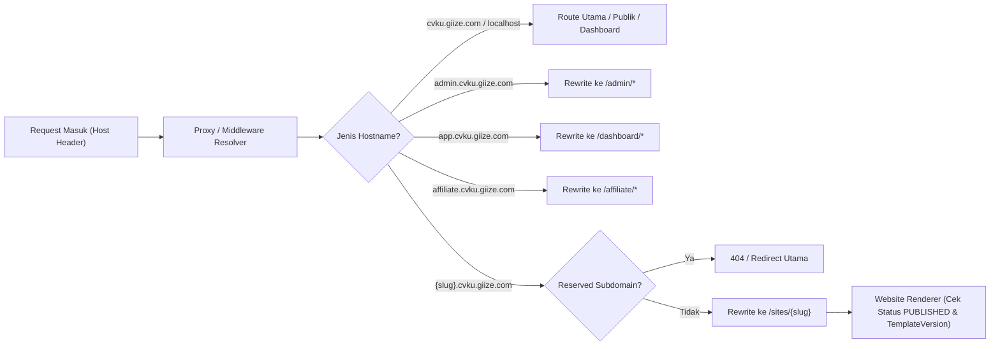
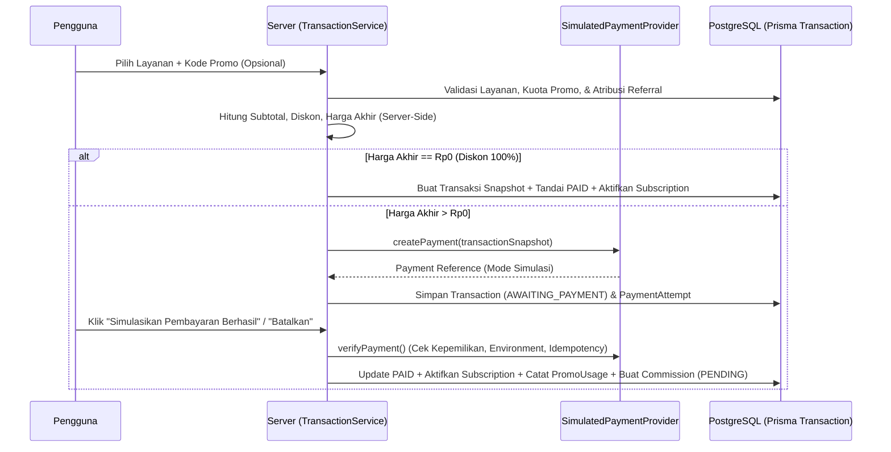

# Arsitektur Sistem Final — CVKU

**Platform:** CVKU — Multi-Tenant Website Builder & Pembuat CV ATS Gratis  
**Domain Utama:** `cvku.giize.com`  
**Wildcard Domain:** `*.cvku.giize.com`  
**Pola Arsitektur:** Modular Monolith, Feature-Based Architecture, Multi-Tenant SaaS  
**Stack Utama:** Next.js App Router (JavaScript), React, Tailwind CSS, shadcn/ui, Prisma ORM, PostgreSQL, Auth.js, Zod, Vercel Blob  

---

## 1. Ringkasan Hasil Audit & Rekonsiliasi Dokumen

Berdasarkan hasil audit terhadap file repository awal (`architecture.md`, `feature.md`, `design.md`, `payment.md`, `prompt.md`, dan `README.md`), ditemukan beberapa perbedaan penting yang diselaraskan dalam dokumen arsitektur final ini:

1. **Penyatuan Modul CV ATS Gratis:** `architecture.md` awal belum memuat modul **Pembuat CV ATS Gratis** dan **Admin Template CV ATS** yang didefinisikan di `feature.md` dan `prompt.md`. Dalam arsitektur final ini, modul `cv-builder` dan `cv-template-management` ditambahkan sebagai domain mandiri dengan renderer dan registry terpisah dari Website Builder.
2. **Strategi Pembayaran Bertahap (Simulasi vs Gateway Sungguhan):** `payment.md` masih kosong, sementara `prompt.md` menegaskan bahwa **payment gateway sungguhan tidak boleh diimplementasikan sebelum Fase 11**. Seluruh alur transaksi pada Fase 8 wajib menggunakan `PaymentProvider` adapter dengan implementasi awal `SimulatedPaymentProvider` yang aman dan divalidasi di server.
3. **Katalog Dinamis (Profesi & Tema) dan Orientasi Pengguna:** Ditambahkan modul `onboarding`, `recommendations`, serta entitas katalog dinamis `Profession` dan `Theme` yang dikelola oleh Admin.
4. **Bahasa Antarmuka vs Kode:** `design.md` memuat beberapa contoh copywriting dalam Bahasa Inggris, sedangkan `prompt.md` dan `feature.md` mewajibkan **100% Bahasa Indonesia** untuk seluruh teks antarmuka pengguna (menu, tombol, label, pesan validasi, notifikasi, copywriting landing page). Seluruh implementasi UI wajib menggunakan Bahasa Indonesia.

---

## 2. Keputusan Teknis yang Dikunci (Architecture Decision Records)

| No. | Area Keputusan | Keputusan Final | Alasan Teknis |
|---:|---|---|---|
| 1 | Bahasa Pemrograman | **JavaScript (ESNext)** dengan `jsconfig.json` (`@/*` alias) | Sesuai instruksi utama proyek; validasi runtime diperkuat dengan Zod di sisi server dan client. |
| 2 | Arsitektur Aplikasi | **Modular Monolith berbasis Fitur (`src/features/*`)** | Menjaga isolasi domain bisnis, memudahkan transaksi database lintas-entitas (`prisma.$transaction`), dan menghindari overhead microservices. |
| 3 | Autentikasi | **Auth.js (NextAuth v5)** dengan Credentials + Google OAuth + Prisma Adapter | Mendukung sesi aman, integrasi langsung dengan Next.js App Router, pencegahan duplikasi akun OAuth, dan RBAC (`USER`, `ADMIN`). |
| 4 | Multi-Tenant Routing | **Next.js Proxy / Middleware (`src/proxy.js` / `src/middleware.js`)** | Membaca header `host`, memfilter *reserved subdomains*, dan melakukan rewrite ke `/sites/[tenant]` (atau `/_sites/[tenant]`) tanpa mengekspos route internal secara tidak aman. |
| 5 | Website & CV Builder | **Component Registry + JSON Schema Tervalidasi** | Mencegah *arbitrary code execution* dan XSS. Admin dan pengguna hanya menyusun komponen React terdaftar dan mengubah properti JSON yang diizinkan. |
| 6 | Ekspor PDF CV ATS | **Server/Client Structured PDF Generation (Selectable Text)** | Menghasilkan dokumen PDF dengan teks yang dapat dipilih (*selectable text*), urutan baca linear satu kolom yang ramah ATS, tanpa merender halaman sebagai gambar raster (screenshot). |
| 7 | Abstraksi Pembayaran | **Adapter Pattern (`PaymentProvider` -> `SimulatedPaymentProvider`)** | Memungkinkan pengujian siklus hidup transaksi, promo, langganan, dan komisi affiliate secara utuh sebelum integrasi payment gateway sungguhan di Fase 11. |
| 8 | Integritas Finansial | **Decimal Database + Transaction Snapshot + Commission Ledger** | Mencegah kesalahan pembulatan floating-point, menjaga histori harga saat layanan berubah, dan mencegah penarikan saldo ganda (*double withdrawal*). |

---

## 3. Struktur Folder Proyek Final

Struktur proyek dirancang mengikuti prinsip *feature-based modular monolith* di dalam `src/`:

```text
cvku/
├── docs/
│   ├── arsitektur.md
│   ├── feature.md
│   ├── design.md
│   ├── database.md
│   ├── api.md
│   ├── development-roadmap.md
│   ├── business-rules.md
│   └── changelog.md
├── prisma/
│   ├── schema.prisma
│   ├── migrations/
│   └── seed.js
├── public/
│   ├── images/
│   ├── icons/
│   └── fonts/
├── src/
│   ├── app/
│   │   ├── (public)/
│   │   │   ├── layout.jsx
│   │   │   ├── page.jsx
│   │   │   ├── templates/
│   │   │   ├── services/
│   │   │   ├── pricing/
│   │   │   ├── cv-ats/
│   │   │   ├── about/
│   │   │   └── faq/
│   │   ├── (auth)/
│   │   │   ├── layout.jsx
│   │   │   ├── login/
│   │   │   ├── register/
│   │   │   ├── forgot-password/
│   │   │   └── reset-password/
│   │   ├── dashboard/
│   │   │   ├── layout.jsx
│   │   │   ├── page.jsx
│   │   │   ├── websites/
│   │   │   ├── builder/[websiteId]/
│   │   │   ├── cv/
│   │   │   ├── services/
│   │   │   ├── checkout/[serviceId]/
│   │   │   ├── transactions/
│   │   │   ├── profile/
│   │   │   └── settings/
│   │   ├── admin/
│   │   │   ├── layout.jsx
│   │   │   ├── page.jsx
│   │   │   ├── users/
│   │   │   ├── professions/
│   │   │   ├── themes/
│   │   │   ├── templates/
│   │   │   ├── cv-templates/
│   │   │   ├── websites/
│   │   │   ├── services/
│   │   │   ├── subscriptions/
│   │   │   ├── transactions/
│   │   │   ├── promo-codes/
│   │   │   ├── affiliates/
│   │   │   ├── commissions/
│   │   │   ├── withdrawals/
│   │   │   ├── analytics/
│   │   │   ├── settings/
│   │   │   └── audit-logs/
│   │   ├── affiliate/
│   │   │   ├── layout.jsx
│   │   │   ├── page.jsx
│   │   │   ├── referrals/
│   │   │   ├── transactions/
│   │   │   ├── commissions/
│   │   │   └── withdrawals/
│   │   ├── sites/
│   │   │   └── [tenant]/
│   │   │       ├── page.jsx
│   │   │       └── [[...slug]]/
│   │   ├── api/
│   │   │   ├── auth/[...nextauth]/
│   │   │   ├── onboarding/
│   │   │   ├── profile/
│   │   │   ├── catalog/
│   │   │   ├── websites/
│   │   │   ├── cv/
│   │   │   ├── transactions/
│   │   │   ├── promo/
│   │   │   ├── affiliate/
│   │   │   ├── admin/
│   │   │   ├── upload/
│   │   │   └── health/
│   │   ├── layout.jsx
│   │   └── globals.css
│   ├── components/
│   │   ├── ui/
│   │   ├── layouts/
│   │   ├── landing/
│   │   ├── forms/
│   │   ├── navigation/
│   │   └── feedback/
│   ├── features/
│   │   ├── auth/
│   │   ├── onboarding/
│   │   ├── user-profile/
│   │   ├── recommendations/
│   │   ├── website-builder/
│   │   ├── website-renderer/
│   │   ├── template-management/
│   │   ├── cv-builder/
│   │   ├── cv-template-management/
│   │   ├── service-management/
│   │   ├── subscription-management/
│   │   ├── transaction-management/
│   │   ├── promo-management/
│   │   ├── affiliate-management/
│   │   ├── commission-management/
│   │   └── analytics/
│   ├── templates/
│   │   ├── website/
│   │   │   ├── registry.js
│   │   │   ├── renderer.jsx
│   │   │   ├── schemas.js
│   │   │   └── components/
│   │   └── cv/
│   │       ├── registry.js
│   │       ├── renderer.jsx
│   │       ├── pdf-generator.js
│   │       ├── schemas.js
│   │       └── components/
│   ├── lib/
│   │   ├── db.js
│   │   ├── auth.js
│   │   ├── permissions.js
│   │   ├── validation.js
│   │   ├── storage.js
│   │   ├── domain.js
│   │   ├── rate-limit.js
│   │   ├── audit.js
│   │   ├── payment/
│   │   │   ├── payment-provider.js
│   │   │   ├── simulated-provider.js
│   │   │   └── index.js
│   │   └── utils.js
│   └── proxy.js
├── .env.example
├── .gitignore
├── jsconfig.json
├── next.config.mjs
├── package.json
└── README.md
```

### Struktur Internal Setiap Modul Fitur (`src/features/<nama-fitur>/`)

Setiap modul bisnis memisahkan tanggung jawab ke dalam subdirektori standar:
- `components/` — Komponen UI spesifik fitur (Client/Server Components).
- `schemas/` — Skema validasi Zod untuk input form dan payload API.
- `services/` — Logika bisnis murni, perhitungan harga/diskon/komisi, dan orkestrasi transaksi.
- `repositories/` — Akses data Prisma ORM terisolasi.
- `actions/` — Next.js Server Actions atau handler integrasi.
- `constants/` — Konstanta, label Bahasa Indonesia, dan konfigurasi default modul.

---

## 4. Alur Arsitektur Inti

### 4.1 Alur Multi-Tenant Subdomain Routing



Daftar *reserved subdomains* yang dikunci di sistem:
`www`, `app`, `admin`, `affiliate`, `api`, `auth`, `dashboard`, `assets`, `support`, `help`, `mail`, `blog`, `status`, `docs`, `cdn`, `static`, `dev`, `staging`, `cv`.

### 4.2 Alur Visual Website Builder & Template Versioning

1. Developer mendaftarkan komponen seksional (`HeroSection`, `AboutSection`, `ExperienceSection`, `PortfolioSection`, `ServiceSection`, `SkillSection`, `TestimonialSection`, `ContactSection`, `FooterSection`) beserta skema Zod propertinya di `src/templates/website/registry.js`.
2. Admin menyusun template di **Visual Template Builder** dan menerbitkan versi baru (`TemplateVersion` v1, v2, dst.).
3. Pengguna membuat website dari template yang dipilih; website mengunci `templateVersionId` saat dibuat.
4. Perubahan pada versi baru oleh Admin tidak merusak website pengguna lama; pengguna dapat memperbarui versi secara eksplisit jika diinginkan.

### 4.3 Alur Pembuat CV ATS & Admin Template CV ATS

1. Developer menyediakan komponen blok CV ATS standar (`CVHeader`, `CVSummary`, `CVExperience`, `CVEducation`, `CVSkills`, `CVProjects`, `CVCertifications`, `CVOrganizations`, `CVAdditional`) di `src/templates/cv/registry.js`.
2. Admin mengonfigurasi tata letak, ukuran kertas (A4/Letter), margin, jenis & ukuran font, warna aksen, pemisah bagian, dan urutan bagian melalui **Editor Template CV ATS**, menguji ekstraksi teks PDF, lalu mempublikasikan `CVTemplateVersion`.
3. Pengguna mengisi data CV terstruktur, memilih atau mengganti template secara *real-time*, menyimpan draf, dan mengunduh PDF secara **gratis** tanpa syarat berlangganan website builder.

### 4.4 Alur Transaksi & Simulasi Pembayaran (Fase 8)



---

## 5. Identifikasi Risiko Teknis & Mitigasi

| No. | Risiko Teknis | Dampak | Strategi Mitigasi |
|---:|---|---|---|
| 1 | **Race Condition pada Kuota Kode Promo** | Kuota promo terlampaui saat terjadi request checkout bersamaan. | Gunakan transaksi database (`prisma.$transaction`) dengan pengecekan atomik dan `unique constraint` pada `PromoUsage(transactionId)`. |
| 2 | **Manipulasi Simulasi Pembayaran di Produksi** | Pengguna mengaktifkan layanan berbayar secara gratis di environment produksi. | Batasi `SimulatedPaymentProvider` hanya ketika `ENABLE_PAYMENT_SIMULATION="true"` dan `NODE_ENV !== "production"` (atau staging khusus), disertai validasi kepemilikan transaksi dan idempotency key di server. |
| 3 | **Hasil PDF CV Tidak Terbaca ATS** | PDF ter-render sebagai gambar bitmap sehingga teks gagal diekstrak oleh mesin ATS. | Gunakan generator PDF berbasis dokumen teks terstruktur (bukan `html2canvas` screenshot) dan sediakan alat uji ekstraksi teks PDF bagi Admin sebelum mempublikasikan template CV. |
| 4 | **Kerusakan Website Lama Saat Admin Mengubah Template** | Struktur JSON baru tidak kompatibel dengan konten website pengguna yang sudah terbit. | Terapkan `TemplateVersion` dan `CVTemplateVersion` yang *immutable* setelah dipublikasikan; website dan CV mengikat ke `versionId` spesifik. |
| 5 | **Penarikan Komisi Ganda (*Double Withdrawal*)** | Affiliate menarik saldo komisi melebihi haknya melalui request paralel. | Gunakan tabel `CommissionLedger` (pencatatan debit/kredit) dan kunci baris/transaksi saat membuat `Withdrawal`. |
| 6 | **Konflik Routing Subdomain vs Route Aplikasi** | Pengguna mendaftarkan subdomain `admin` atau `api` yang mengambil alih route sistem. | Validasi ketat terhadap daftar *reserved subdomains* baik di level Zod schema, database service, maupun di `src/proxy.js`. |
| 7 | **Kebijakan Eksekusi Script PowerShell Lokal (Windows)** | Perintah `npm` atau `npx` gagal dijalankan karena `npm.ps1` diblokir oleh PowerShell ExecutionPolicy. | Gunakan `npm.cmd` dan `npx.cmd` untuk eksekusi CLI di lingkungan Windows PowerShell. |
