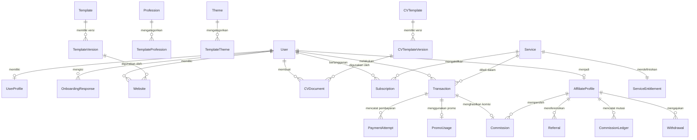

# Rancangan Database PostgreSQL & Prisma — CVKU

Dokumen ini mendefinisikan rancangan database PostgreSQL menggunakan Prisma ORM untuk mendukung seluruh kebutuhan bisnis CVKU secara modular, aman, dan dapat diaudit.

---

## 1. Prinsip Desain Skema Database

1. **Primary Key:** Menggunakan `cuid()` pada seluruh tabel utama untuk keamanan URL dan performa indeks.
2. **Tipe Data Finansial:** Seluruh nilai nominal uang (harga layanan, diskon, total transaksi, komisi, saldo, penarikan) wajib menggunakan `Decimal` (`@db.Decimal(15, 2)`), bukan `Float`.
3. **Immutability & Histori (Snapshot):**
   - `Transaction` menyimpan JSON snapshot rincian harga, layanan, promo, dan referral pada saat checkout.
   - `TemplateVersion` dan `CVTemplateVersion` mengunci konfigurasi desain dan struktur komponen agar pembaruan oleh Admin tidak merusak website atau CV lama.
   - `CommissionLedger` mencatat setiap mutasi saldo komisi affiliate secara historis (kredit/debit/reversal).
4. **Indeks & Unique Constraints:** Seluruh kolom pencarian utama (`email`, `slug`, `subdomain`, `code`, `referralCode`) memiliki `@unique` dan `@index` yang optimal.

---

## 2. Daftar Enum Utama

```prisma
enum UserRole {
  USER
  ADMIN
}

enum AccountStatus {
  ACTIVE
  SUSPENDED
  DEACTIVATED
}

enum OnboardingStatus {
  NOT_STARTED
  IN_PROGRESS
  COMPLETED
  SKIPPED
}

enum CatalogStatus {
  DRAFT
  PUBLISHED
  ARCHIVED
}

enum WebsiteStatus {
  DRAFT
  PUBLISHED
  SUSPENDED
  ARCHIVED
}

enum DomainVerificationStatus {
  PENDING
  VERIFIED
  FAILED
}

enum BillingPeriod {
  MONTHLY
  YEARLY
  LIFETIME
  ONE_TIME
}

enum ServiceStatus {
  DRAFT
  ACTIVE
  INACTIVE
  ARCHIVED
}

enum SubscriptionStatus {
  PENDING
  ACTIVE
  EXPIRED
  CANCELLED
  SUSPENDED
}

enum TransactionStatus {
  PENDING
  AWAITING_PAYMENT
  PAID
  FAILED
  EXPIRED
  CANCELLED
  REFUNDED
  PARTIALLY_REFUNDED
}

enum PaymentProviderType {
  SIMULATED
  ZERO_PRICE
  GATEWAY
}

enum PaymentAttemptStatus {
  INITIATED
  SUCCESS
  FAILED
  CANCELLED
  EXPIRED
}

enum DiscountType {
  PERCENTAGE
  FIXED_AMOUNT
  FULL
}

enum PromoStatus {
  ACTIVE
  INACTIVE
  EXPIRED
  DEPLETED
}

enum AffiliateStatus {
  PENDING
  ACTIVE
  REJECTED
  SUSPENDED
  TERMINATED
}

enum ReferralStatus {
  CLICKED
  REGISTERED
  CONVERTED
  INVALID
}

enum CommissionType {
  PERCENTAGE
  FIXED_AMOUNT
}

enum CommissionStatus {
  PENDING
  APPROVED
  REJECTED
  PAID
  REVERSED
}

enum LedgerEntryType {
  CREDIT_APPROVED
  DEBIT_WITHDRAWAL
  DEBIT_REVERSAL
  CREDIT_ADJUSTMENT
}

enum WithdrawalStatus {
  PENDING
  APPROVED
  REJECTED
  PROCESSING
  PAID
  CANCELLED
}
```

---

## 3. Spesifikasi Entitas per Domain

### 3.1 Autentikasi, Pengguna, dan Orientasi (Onboarding)

- **`User`**: Menyimpan kredensial utama (`id`, `name`, `email`, `emailVerified`, `passwordHash`, `image`, `role`, `status`, `createdAt`, `updatedAt`).
- **`Account`**, **`Session`**, **`VerificationToken`**, **`PasswordResetToken`**: Standar Auth.js / NextAuth dan pemulihan kata sandi.
- **`UserProfile`**: Informasi lanjutan pengguna (`userId` unique, `phone`, `bio`, `domicile`, `avatarUrl`, `linkedinUrl`, `portfolioUrl`, `githubUrl`, `customProfession`, `acquisitionSource`, `onboardingStatus`, `onboardingCompletedAt`, `themePreference`).
- **`UserInterest`**: Minat pembuatan yang dipilih pengguna (`id`, `userId`, `interestKey`, `customLabel`).
- **`UserProfession`**: Relasi pengguna ke profesi katalog (`id`, `userId`, `professionId`, `isPrimary`).
- **`OnboardingResponse`**: Catatan historis pengisian popup orientasi (`id`, `userId`, `formVersion`, `acquisitionSource`, `acquisitionCustom`, `selectedInterests` JSON, `professionId`, `customProfession`, `skipped`, `completedAt`).

### 3.2 Katalog Dinamis & Template Website

- **`Profession`**: Dikelola admin (`id`, `name`, `slug` unique, `description`, `icon`, `sortOrder`, `isActive`).
- **`Theme`**: Dikelola admin (`id`, `name`, `slug` unique, `description`, `sortOrder`, `isActive`).
- **`Template`**: Entitas induk template website (`id`, `name`, `slug` unique, `description`, `thumbnailUrl`, `previewUrl`, `status`, `isFeatured`, `isPremium`, `usageCount`, `currentVersionId`, `publishedAt`).
- **`TemplateVersion`**: Versi immutable dari konfigurasi template (`id`, `templateId`, `versionNumber`, `changelog`, `designConfig` JSON, `sectionsConfig` JSON, `isPublished`, `createdById`, `createdAt`).
- **`TemplateProfession`**: Relasi many-to-many antara `Template` dan `Profession`.
- **`TemplateTheme`**: Relasi many-to-many antara `Template` dan `Theme`.

### 3.3 Website Builder, Domain, dan Analitik

- **`Website`**: Website milik pengguna (`id`, `userId`, `name`, `subdomain` unique, `description`, `faviconUrl`, `seoTitle`, `seoDescription`, `templateId`, `templateVersionId`, `designConfig` JSON, `status`, `publishedAt`, `createdAt`, `updatedAt`).
- **`WebsitePage`**: Halaman di dalam website (`id`, `websiteId`, `title`, `slug`, `isHomePage`, `sectionsContent` JSON, `seoMeta` JSON, `sortOrder`, `isPublished`).
- **`WebsiteDomain`**: Konfigurasi custom domain (`id`, `websiteId`, `domain` unique, `isPrimary`, `verificationStatus`, `verificationToken`, `sslStatus`, `verifiedAt`).
- **`WebsiteAnalytics`**: Pencatatan kunjungan harian & event ringkas (`id`, `websiteId`, `date`, `pagePath`, `viewsCount`, `uniqueVisitorsCount`, `deviceBreakdown` JSON, `referrerBreakdown` JSON).

### 3.4 Pembuat CV ATS & Template CV ATS

- **`CVTemplate`**: Entitas induk template CV ATS yang dikelola admin (`id`, `name`, `slug` unique, `description`, `category`, `thumbnailUrl`, `status`, `currentVersionId`, `usageCount`, `publishedAt`).
- **`CVTemplateVersion`**: Konfigurasi versi template CV ATS (`id`, `cvTemplateId`, `versionNumber`, `pageSize` [A4/LETTER], `marginsConfig` JSON, `typographyConfig` JSON, `colorConfig` JSON, `sectionsOrder` JSON, `headingStyleConfig` JSON, `atsTestPassed`, `atsTestReport` JSON, `isPublished`, `createdAt`).
- **`CVDocument`**: Dokumen CV milik pengguna (`id`, `userId`, `title`, `targetRole`, `cvTemplateId`, `cvTemplateVersionId`, `personalInfo` JSON, `summary` Text, `experiences` JSON, `educations` JSON, `skills` JSON, `projects` JSON, `certifications` JSON, `organizations` JSON, `additionalInfo` JSON, `sectionVisibility` JSON, `customSectionOrder` JSON, `completenessScore` Int, `lastExportedAt`, `createdAt`, `updatedAt`).

### 3.5 Layanan, Entitlement, dan Langganan

- **`Service`**: Paket layanan yang dikelola admin (`id`, `name`, `slug` unique, `description`, `price` Decimal, `billingPeriod`, `durationDays` Int?, `isPopular`, `sortOrder`, `status`, `createdAt`, `updatedAt`).
- **`ServiceEntitlement`**: Hak akses yang melekat pada layanan (`id`, `serviceId` unique, `maxWebsites` Int, `maxStorageMB` Int, `templateAccess` String [FREE_ONLY / ALL], `allowCustomDomain` Boolean, `allowAnalytics` Boolean, `allowRemoveBranding` Boolean, `extraFeatures` JSON).
- **`Subscription`**: Langganan pengguna (`id`, `userId`, `serviceId`, `status`, `entitlementSnapshot` JSON, `startsAt`, `expiresAt`, `cancelledAt`, `createdAt`, `updatedAt`).

### 3.6 Transaksi, Pembayaran Simulasi, dan Kode Promo

- **`PromoCode`**: Kode diskon admin (`id`, `code` unique, `name`, `description`, `discountType`, `discountValue` Decimal, `minimumPurchase` Decimal, `maxUsage` Int?, `maxUsagePerUser` Int, `usedCount` Int, `appliesToAllServices` Boolean, `appliesToAllUsers` Boolean, `startsAt`, `expiresAt`, `status`, `createdById`, `createdAt`).
- **`PromoService`**: Batasan layanan untuk promo tertentu (`promoCodeId`, `serviceId`).
- **`PromoUser`**: Batasan pengguna untuk promo tertentu (`promoCodeId`, `userId`).
- **`Transaction`**: Catatan pembelian (`id`, `invoiceNumber` unique, `userId`, `serviceId`, `subscriptionId`?, `promoCodeId`?, `affiliateProfileId`?, `referralCodeUsed`?, `subtotalAmount` Decimal, `discountAmount` Decimal, `taxAmount` Decimal, `totalAmount` Decimal, `currency` default "IDR", `status`, `providerType`, `isSimulated` Boolean, `transactionSnapshot` JSON, `idempotencyKey` unique, `paidAt`, `expiresAt`, `cancelledAt`, `refundedAt`, `createdAt`, `updatedAt`).
- **`TransactionItem`**: Rincian item dalam transaksi (`id`, `transactionId`, `serviceId`, `itemName`, `unitPrice` Decimal, `quantity` Int, `totalPrice` Decimal, `metadata` JSON).
- **`PaymentAttempt`**: Percobaan pembayaran / simulasi (`id`, `transactionId`, `provider`, `externalReference` unique, `amount` Decimal, `status`, `isSimulated` Boolean, `payloadSnapshot` JSON, `completedAt`, `createdAt`).
- **`PromoUsage`**: Histori pemakaian promo (`id`, `promoCodeId`, `userId`, `transactionId` unique, `discountApplied` Decimal, `usedAt`).

### 3.7 Affiliate, Referral, Komisi, dan Penarikan

- **`AffiliateProfile`**: Profil affiliate pada akun USER (`id`, `userId` unique, `referralCode` unique, `status`, `policyVersionSnapshot` JSON, `totalReferrals` Int, `totalEarned` Decimal, `availableBalance` Decimal, `withdrawnAmount` Decimal, `bankName`, `bankAccountNumber`, `bankAccountHolder`, `approvedAt`, `createdAt`, `updatedAt`).
- **`Referral`**: Atribusi pengguna yang direferensikan (`id`, `affiliateProfileId`, `referredUserId` unique, `referralCode`, `status`, `attributedAt`, `convertedAt`, `expiresAt`, `metadata` JSON).
- **`Commission`**: Komisi dari transaksi referral (`id`, `affiliateProfileId`, `referralId`, `transactionId` unique, `commissionType`, `commissionRate` Decimal, `baseAmount` Decimal, `commissionAmount` Decimal, `status`, `ruleSnapshot` JSON, `availableAt`, `approvedAt`, `reversedAt`, `reversalReason`, `createdAt`).
- **`CommissionLedger`**: Buku besar saldo komisi (`id`, `affiliateProfileId`, `commissionId`?, `withdrawalId`?, `entryType`, `amount` Decimal, `balanceAfter` Decimal, `description`, `createdAt`).
- **`Withdrawal`**: Permintaan pencairan komisi (`id`, `affiliateProfileId`, `amount` Decimal, `status`, `payoutMethod`, `payoutDetails` JSON, `adminNote`, `paymentProofUrl`, `processedById`, `requestedAt`, `processedAt`).

### 3.8 Sistem, Notifikasi, Pengaturan, dan Audit Log

- **`Notification`**: Notifikasi in-app pengguna (`id`, `userId`, `title`, `message`, `type`, `actionUrl`, `isRead`, `readAt`, `createdAt`).
- **`AuditLog`**: Catatan aktivitas sensitif (`id`, `actorId`, `actorRole`, `action`, `entityType`, `entityId`, `beforeData` JSON, `afterData` JSON, `ipAddress`, `userAgent`, `createdAt`).
- **`PlatformSetting`**: Konfigurasi global yang dapat diubah admin (`id`, `key` unique, `value` JSON, `category`, `description`, `updatedById`, `updatedAt`).

---

## 4. Diagram Relasi Inti (ERD)


